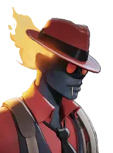

# Deadlock Dossier

Интерактивная картотека секретных досье на персонажей игры **Deadlock** от Valve, стилизованная под ретро-архив Нью-Йоркского Департамента надзора за аномалиями.



---

## 🗄️ Особенности проекта

* **Архивный шкаф с 3D-секциями по алфавиту**:
  * **`A — H`**: Abrams, Bebop, Dynamo, Grey Talon, Haze
  * **`I — P`**: Infernus, Ivy, Kelvin, Lady Geist, Lash, McGinnis, Mirage, Mo & Krill, Paradox, Pocket
  * **`Q — Z`**: Seven, Shiv, Vindicta, Viscous, Warden, Wraith, Yamato
* **Интерактивные подвесные папки (Manila Folders)**:
  * Расположение ярлычков со смещением (staggered tabs) поперек ящика.
  * При наведении курсора папка плавно приподнимается и отбрасывает тень.
* **Полное секретное досье на каждого героя**:
  * Портрет субъекта со скрепкой в стиле магшота.
  * Паспорт субъекта (роль, сложность, оружие).
  * Боевые показатели (Живучесть, Оружие, Спиритизм, Мобильность).
  * Биография и оперативная сводка.
  * Полный реестр всех 4 способностей с описаниями и типами.
  * Тактические рекомендации и советы по комбо.
  * Навигация между досье стрелками клавиатуры (`← / →`) и закрытие по `ESC`.
* **Аудио-движок Web Audio API**:
  * Процедурный синтез звуков шелеста бумаги, щелчков ящиков и штампов без внешних файлов.
* **Быстрый поиск**:
  * Живой фильтр по имени или роли с автоматическим открытием нужной секции.

---

## 🚀 Запуск

Проект написан на чистом Vanilla JS, HTML5 и CSS3. Никаких сборок и зависимостей не требуется:

1. Склонируйте репозиторий:
   ```bash
   git clone git@github.com:Gcutter5509/DeadlockDossier.git
   ```
2. Откройте файл `index.html` в любом современном браузере.
